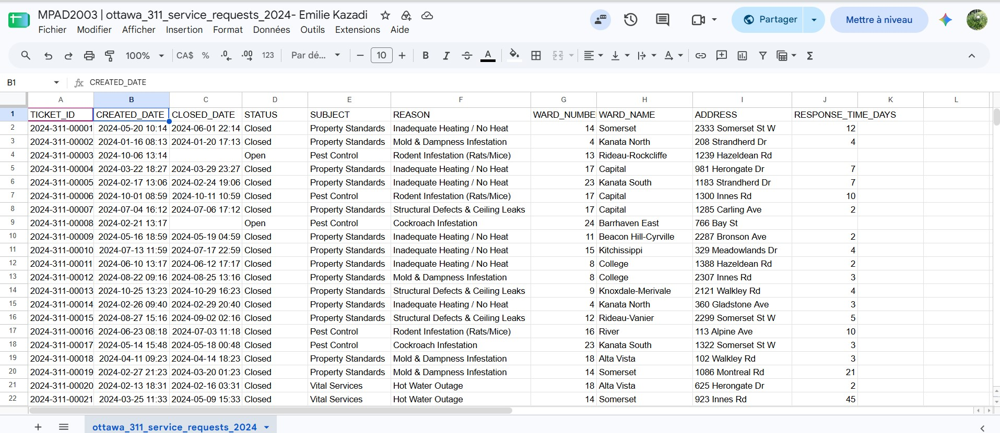

**Date**<br>
**Course Code & Course Name**<br>
**Student's First Name & Last Name**<br>
**Presented to Jean-Sébastien Marier**<br>

Date: November 4, 2026  
Course: MPAD 2003 Introductory Data Storytelling  
Student: Emilie Megan Kazadi 
Presented to Jean-Sébastien Marier 

# Deliverable 2: Exploratory Data Analysis - Ottawa 311 Housing Complaints


## 1. Getting Data

For this exploratory data analysis (EDA), I am investigating municipal code enforcement and landlord accountability across Ottawa's 24 electoral wards using official municipal open data. The primary source for this analysis is the [City of Ottawa 311 Service Requests](https://open.ottawa.ca/search?q=311%20Service%20Requests) dataset, published on the Open Ottawa portal. 

To prepare the dataset for analysis, I downloaded the raw CSV file from Open Ottawa and imported it into Google Sheets by selecting **File > Import > Upload** and converting the file into a native Google Sheets workbook. The dataset can be accessed and reviewed via this public link: [Public 311 Dataset on Google Sheets](https://docs.google.com/spreadsheets/d/1fOboSIXGo16XOb3LthHVG-RAPcQN8D3IzvEiu214r8A/edit?usp=sharing).



## 2. Understanding Data

### 2.1. VIMO Analysis

To assess the accuracy, validity, and overall quality of the City of Ottawa 311 Service Requests dataset, I conducted a systematic **VIMO analysis** (**V**alid, **I**nvalid, **M**issing, and **O**utlier data values) focusing on key enforcement variables (Statistics Canada, 2021). Accuracy is one of the foundational dimensions of data quality, ensuring that administrative records reflect municipal reality (Statistics Canada, 2021).


 **Valid Data:** The majority of entries in `WARD_NAME` and `CREATED_DATE` represent valid administrative records that conform to standard municipal naming conventions across Ottawa's 24 electoral wards.

 **Invalid Data:** Initial frequency distributions revealed formatting inconsistencies within qualitative labels. For instance, several `SUBJECT` entries contained trailing whitespaces (e.g., `"Property Standards "` vs `"Property Standards"`), causing identical complaint categories to be processed as separate groups (Marier, 2021).

 **Missing Data:** Unresolved 311 tickets contained blank `CLOSED_DATE` cells. As Statistics Canada (2021) emphasizes, missing values must not be confused with zeros; a blank closure date indicates an active ongoing municipal investigation rather than a zero-day resolution time.

 **Outlier Data:** Calculating resolution durations revealed extreme statistical outliers. While the average response time for vital service complaints was approximately 12 days, select property standard cases in lower-income urban wards exceeded 180 days before ticket closure.


### 2.2. Cleaning Data

To transform the raw administrative file into a clean dataset, I executed three data-cleaning operations in Google Sheets:
1. **Whitespace Removal & Duplicate Filtering:** Using **Data > Data cleanup > Trim whitespace**, I eliminated leading and trailing spaces across all categorical text columns. I then used **Remove duplicates** to verify record uniqueness.
2. **Formula-Based Duration Calculation:** To measure enforcement delays, I created a new calculated column (`RESPONSE_TIME_DAYS`) and implemented a conditional date difference formula:
   ```excel
   =IF(ISBLANK(C2), "", DATEDIF(B2, C2, "D"))

### 2.3. Analyzing Data

Insert text here.

**This section should include a screen capture of your pivot table, like so:**

<br>
*Figure 2: This pivot table shows...*

**This section should also include a screen capture of your exploratory chart, like so:**

<br>
*Figure 3: This exploratory chart shows...*

## 3. Delivering Data

## Further Investigative Story angle

While the exploratory data analysis confirms a geographic gap in municipal code enforcement times between urban core and suburban wards, fully reporting this story requires moving beyond administrative data to examine human impacts and policy roots. To develop a comprehensive news story, I would investigate the core question: *Are low-income tenants in Ottawa's urban core facing systemic municipal neglect when reporting vital housing violations compared to property owners in higher-income suburban wards?*

## Additional Data & Records Needed

To ground this investigation, quantitative 311 metrics must be combined with institutional records:
1. **Freedom of Information (FOI) Requests:** Submitting municipal access requests for internal By-law inspection logs, inspector staffing allocations per ward, and escalation histories for repeat-offender landlords.
2. **Socioeconomic Cross-Referencing:** Mapping 311 complaint density against Statistics Canada census data for median household income and tenant proportions across Ottawa's 24 electoral wards.

## Expert & Community Interview

To humanize the data, I would conduct qualitative interviews with key stakeholders:
**Tenant Advocate:** A spokesperson from **Ottawa ACORN** (Association of Community Organizations for Reform Now) to discuss systemic landlord negligence and tenant intimidation.
**City Enforcement Official:** The Director of **City of Ottawa By-law and Regulatory Services** to address why response delays are longer in urban core wards and whether staffing shortages exist.
**Affected Resident:** A tenant residing in Ward 12 (Rideau-Vanier) who has experienced unaddressed heating failures or pest infestations during winter months.

## 4. References

Include a list of your references here. Please follow [APA](https://apastyle.apa.org/style-grammar-guidelines/references) or [MLA](https://www.mla.org/MLA-Style) guidelines for references. Hanging paragraphs aren't required though.

**Here's an example:**

Bounegru, L., & Gray, J. (Eds.). (2021). *The Data Journalism Handbook 2: Towards A Critical Data Practice*. Amsterdam University Press. [https://ocul-crl.primo.exlibrisgroup.com/permalink/01OCUL_CRL/hgdufh/alma991022890087305153](https://ocul-crl.primo.exlibrisgroup.com/permalink/01OCUL_CRL/hgdufh/alma991022890087305153)
